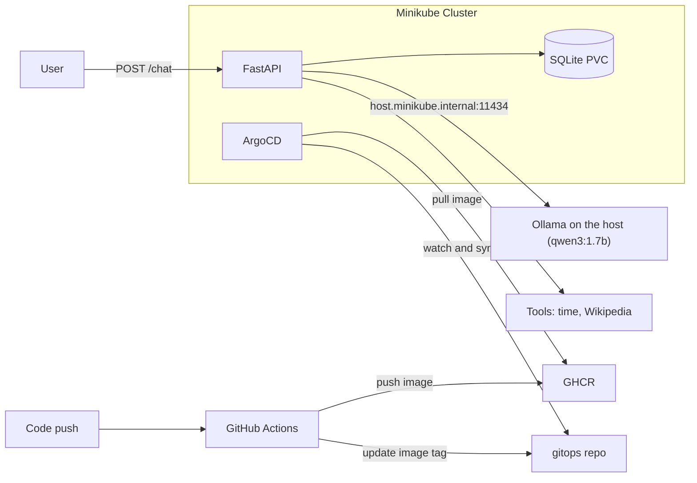

# Local AI Agent Service

A production-style AI agent that runs entirely on a local machine. It answers questions, calls tools when it needs extra information, and is deployed the same way a real service would be: containers, Kubernetes, GitOps, and an automated pipeline. No paid APIs and no credit card.

## What it does

A user sends a message to a chat API. The API talks to a local language model (qwen3:1.7b through Ollama). If the model needs something it does not know, such as the current time or a Wikipedia lookup, it asks the service to run a tool, then uses the result to write the final answer. Conversation history is stored so follow-up questions keep their context.

## Goal

Show the full path of an AI service, from the agent itself to how it is packaged, deployed, and updated automatically:

1. A working agent with tool calling and memory.
2. A local environment that starts with one command.
3. A Kubernetes deployment managed by ArgoCD.
4. A CI/CD pipeline that builds, publishes, and deploys on every push.
5. Documentation, an architecture diagram, and a short demo.

After the model is downloaded once, chat works offline.

## Tech stack

| Area | Choice |
| --- | --- |
| API | Python 3.11+, FastAPI |
| Model | qwen3:1.7b via Ollama (OpenAI-compatible API on port 11434) |
| Agent logic | Custom tool-calling loop against Ollama `/api/chat` |
| Memory | SQLite |
| Containers | Docker and Docker Compose |
| Cluster | Kubernetes on Minikube |
| Infrastructure | Terraform |
| GitOps | ArgoCD |
| CI/CD | GitHub Actions |
| Image registry | GitHub Container Registry (GHCR) |
| Monitoring | Prometheus and Grafana |

## Design decisions

- **Ollama stays on the host machine.** It is already installed and the model is already downloaded. Docker Compose reaches it at `host.docker.internal:11434`. Pods in Minikube reach it at `host.minikube.internal:11434`.
- **The agent loop is custom code.** The service sends messages and a tool list to Ollama, runs any tool the model requests, and sends the result back. This makes the agent behavior visible instead of hiding it inside a framework.
- **Memory is a single SQLite file.** Locally it lives on a Docker volume. In the cluster it lives on a persistent volume. The API runs as one replica, because SQLite has a single writer.
- **Two Git repositories.**
  - `local-ai-agent` holds the application, Dockerfile, Compose file, Terraform, and CI workflow.
  - `local-ai-agent-gitops` holds only Kubernetes manifests. ArgoCD watches this repo and applies whatever is in Git.

## Architecture



A code push runs tests, builds an image, and publishes it to GHCR. The pipeline then updates the image tag in the GitOps repo. ArgoCD sees that commit and rolls the new version out to the cluster. A chat request goes to FastAPI, which calls Ollama on the host and runs tools when the model asks for them.

## API contract

The service reads `OLLAMA_BASE_URL`, `OLLAMA_MODEL`, and `DB_PATH` from the environment and listens on port 8000.

| Method | Path | Purpose |
| --- | --- | --- |
| `GET` | `/health` | Liveness and readiness |
| `GET` | `/metrics` | Prometheus metrics |
| `POST` | `/chat` | Send a message and get a reply |

```json
// POST /chat
{ "session_id": "abc", "message": "What time is it in Tokyo?" }

// response
{ "reply": "It is 02:14 in Tokyo.", "tool_calls": ["get_current_time"] }
```

## Repository layout

```
local-ai-agent/
  app/
    main.py            # FastAPI app: /chat, /health, /metrics
    config.py          # settings from the environment
    llm.py             # HTTP client for Ollama /api/chat
    agent.py           # tool-calling loop
    tools.py           # get_current_time, wikipedia_search, and their schemas
    memory.py          # SQLite: save and load messages by session_id
    schemas.py         # request and response models
  tests/               # pytest, with Ollama mocked
  Dockerfile
  docker-compose.yml
  requirements.txt
  terraform/
    main.tf            # Minikube cluster and Helm releases
    variables.tf
    outputs.tf
  .github/workflows/ci.yml
  docs/architecture.md
  README.md

local-ai-agent-gitops/
  apps/agent/
    deployment.yaml
    service.yaml
    pvc.yaml
    configmap.yaml
    kustomization.yaml # CI updates the image tag here
  argocd/application.yaml
```

## Six-week plan

### Week 1 — Setup and foundation

Concepts: what an LLM server is, REST APIs, containers versus host networking.

- Confirm Ollama answers through `http://localhost:11434/api/chat` with `qwen3:1.7b`.
- Make Ollama listen on all interfaces (`OLLAMA_HOST=0.0.0.0`) so containers can reach it.
- Scaffold FastAPI with `/health` and a `/chat` endpoint that returns a mock reply.
- Write a Dockerfile (`python:3.11-slim`, non-root user, health check) and a Compose file that points the API at `host.docker.internal:11434` and stores data on a named volume.
- Create both GitHub repositories.

Done when `docker compose up` serves the mock chat endpoint.

### Week 2 — Agent core

Concepts: message roles, tool calling, the agent loop, conversation state.

- Call Ollama `/api/chat` with `stream: false` and `think: false`.
- Add two tools, each with a JSON schema:
  - `get_current_time(timezone)`, which works offline.
  - `wikipedia_search(query)`, which needs the internet and returns a clear error when offline.
- Implement the loop, capped at about 5 steps: send messages, run any requested tools, append each result as a tool message, repeat until the model returns plain text.
- Store messages in SQLite (`session_id`, `role`, `content`, `created_at`) and reload the recent history for each session.
- Add tests with Ollama mocked, plus a Makefile (`make up`, `make test`).

Done when "what time is it in Tokyo?" triggers the time tool, and a follow-up question still has the earlier context. The SQLite file survives `docker compose down` and `up`.

### Week 3 — Terraform and Kubernetes

Concepts: infrastructure as code, Terraform state, Pods, Deployments, Services, ConfigMaps, persistent volumes, probes.

- Provision a local Minikube cluster with Terraform (Docker driver, about 2 CPUs and 4 GB RAM).
- Write manifests: a ConfigMap with the Ollama URL, a Deployment (1 replica, resource limits, probes on `/health`, volume mounted at `/data`), a Service, and a persistent volume claim.
- Build the image into Minikube for this week. The registry comes in week 5.
- Log a startup check that reports whether Ollama is reachable.

Done when `kubectl port-forward svc/agent 8000:80` serves a real chat, and a pod can reach Ollama at `host.minikube.internal:11434`.

### Week 4 — GitOps with ArgoCD

Concepts: desired state versus actual state, reconciliation, Kustomize, drift, self-heal.

- Install ArgoCD with Terraform through the `argo/argo-cd` Helm chart.
- Add an ArgoCD Application that points at `apps/agent`, with automated sync, prune, and self-heal.
- Confirm the idea with two checks: a Git change (replica count or an environment variable) shows up in the cluster, and deleting the Deployment by hand causes ArgoCD to recreate it.

Done when a Git commit is enough to change the cluster.

### Week 5 — CI/CD

Concepts: pipelines, image tags, secrets, and the split between building and deploying.

On every push to `main`:

1. Lint with `ruff` and run `pytest`.
2. Build the image and push `ghcr.io/<user>/local-ai-agent:<git-sha>`.
3. Check out the GitOps repo, set the image tag with Kustomize, and push that commit.

Pull requests run tests only. The GHCR package is public so Minikube can pull it without registry credentials.

Done when a small code change, once pushed, is running in the cluster within a few minutes with no manual step.

### Week 6 — Monitoring, documentation, and final test

Concepts: metrics, dashboards, documentation as part of the delivery.

- Expose request metrics and a counter for tool calls.
- Install the Prometheus stack and add one Grafana dashboard: request rate, latency, and error rate.
- Write the project README: architecture, prerequisites, Compose quickstart, Kubernetes quickstart, CI/CD flow, screenshots, and troubleshooting.
- Record a short demo: a chat that uses a tool, then a code push that deploys itself.
- Rebuild from scratch with `terraform destroy` and `terraform apply` and run the full flow again.

## Deliverables

- FastAPI agent connected to local Ollama, with at least one tool and conversation memory.
- `docker compose up` runs the API against the host Ollama.
- Kubernetes deployment on Minikube, kept in sync by ArgoCD.
- GitHub Actions pipeline: test, push to GHCR, update the GitOps repo, automatic deploy.
- README with an architecture diagram, plus a short demo.

## Constraints

- Free only. Ollama, GHCR, GitHub Actions, Minikube, and ArgoCD do not require a credit card.
- Works offline after the model download, except Wikipedia search and anything that talks to GitHub (image pulls and GitOps sync).

## Things to watch

- Ollama listens on localhost unless `OLLAMA_HOST=0.0.0.0` is set, so containers cannot reach it until that is changed.
- A host firewall can block port 11434 from Docker and Minikube networks.
- qwen3:1.7b is a small model. Tool descriptions stay short, and the loop stops after a few steps.
- One replica only. SQLite on a single-writer volume cannot be shared. More replicas would need a different database, such as Redis.
